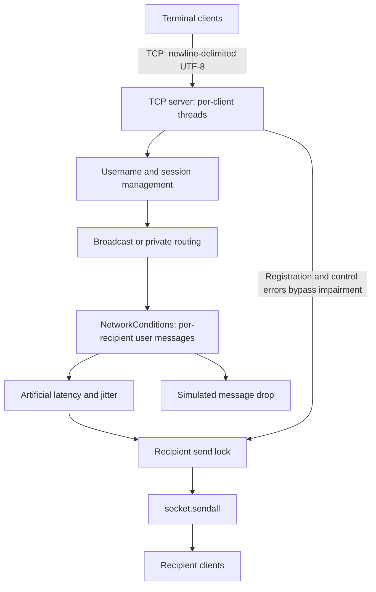

# TCP Multi-Client Chat

[](https://github.com/its-spark-dev/tcp-multiclient-chat/actions/workflows/tests.yml)

A concurrent TCP chat system with broadcast and private messaging, plus controlled network-condition simulation and server send-path metrics. Built in Python using only the standard library.

## Why This Project

This project makes TCP stream framing, concurrent socket handling, shared-state synchronization, and message routing visible in a small implementation. It originated as a four-person Ohio State CSE 3461 networking project and was subsequently cleaned up for public portfolio use. The final system combines all four contributors' work; [CONTRIBUTORS.md](CONTRIBUTORS.md) documents responsibilities and supporting history.

## Features

- Multi-client IPv4 TCP server with one worker thread per connection.
- Unique, case-sensitive username registration: 1–24 ASCII letters, digits, or underscores.
- Broadcast messages to every other registered client.
- `@username message` private routing with sender-only validation errors.
- Newline-delimited UTF-8 framing that handles fragmented and coalesced reads.
- Disconnect cleanup, username reuse, and coordinated server shutdown.
- Artificial latency, jitter, and application-level simulated message loss.
- Per-recipient delivery attempts, simulated drops, socket-send outcomes, and delay/throughput metrics.

## Architecture



The primary entry points are `src/server.py` and `src/client.py`. See [architecture.md](docs/architecture.md) for protocol, locking, and shutdown details.

## Message Flow

- **Broadcast:** `hello everyone` → server → all other registered clients as `[Alice] hello everyone`. The sender receives no echo.
- **Private:** `@Bob hello` → server username lookup → Bob alone as `[Private] Alice: hello`. There is no sender delivery confirmation.

Unknown targets, self-messages, and missing private-message bodies produce sender-only errors. Enter `/quit` to disconnect.

## TCP Framing

TCP carries a byte stream: a single `recv()` may contain part of a message or multiple messages. `src/protocol.py` accumulates bytes until a newline, extracts each complete frame, and then decodes UTF-8. This also handles characters split across reads. Incomplete frames remain buffered; a trailing frame without a newline is discarded at disconnect. Embedded newlines delimit separate messages.

## Concurrency and Synchronization

Each accepted connection has its own worker thread. A shared lock protects username/session state; routing copies recipients or looks up a target under that lock, then releases it before delays and socket I/O. Each recipient has a separate send lock to keep concurrent writes from interleaving frames. Disconnect cleanup removes only the mapping owned by that connection, releases the username, and closes the socket. Shutdown closes tracked connections and joins worker threads.

## Network Condition Simulation

For each intended recipient, `NetworkConditions` independently decides whether to drop a user message. A pass waits for fixed latency plus uniform positive/negative jitter, clamped to zero, before the socket send. Registration and control errors bypass impairment. A seed reproduces random decisions for a fixed call order; concurrent scheduling can change recipient assignment.

This is **application-level message loss**, not actual TCP packet loss or retransmission modeling. `sendall()` success means the local socket send completed; it does not acknowledge receipt or display by the client. The server prints cumulative metrics when stopped with Ctrl+C. See [Network condition simulation details and metric definitions](docs/feature3.md).

## Results

The existing [team-recorded simulation run](docs/feature3.md#recorded-demonstration-results) reports:

| Metric | Recorded value |
| --- | ---: |
| Recipient delivery attempts | 96 |
| Simulated drops | 16 |
| Simulator passes / successful socket sends | 80 / 80 |
| Socket send failures | 0 |
| Server-send delivery rate | 83.33% |
| Mean requested artificial delay | 49.28 ms |
| Effective throughput | 4.785 successful sends/sec |
| Elapsed interval | 16.720 seconds |

These results demonstrate consistent per-recipient accounting and successful socket sends for all simulator passes. They describe the server send path, including inter-message gaps, rather than end-to-end latency or actual network throughput. The exact configuration and a matching baseline were not recorded in the available documentation, so no baseline performance reduction is claimed.

## Quick Start

Python 3.11 or newer is recommended; no dependency installation is required. Run commands from the repository root. The canonical client is `src/client.py`, which supports macOS/Linux terminals.

Choose **one** of the following modes. Each mode pairs one server command with its matching client command. Run the server in one terminal and each client in a separate terminal. When switching modes, stop the current server with Ctrl+C and reconnect clients using the new mode's command.

### Baseline Localhost

Start the server on `127.0.0.1:5000` with no simulated impairment:

```bash
python3 src/server.py
```

Start two or more clients on the same computer:

```bash
python3 src/client.py
```

### LAN

On the server computer, listen on all IPv4 interfaces on port `5001`:

```bash
python3 src/server.py --host 0.0.0.0 --port 5001
```

On each client computer, replace `SERVER_IP` with the server's reachable IPv4 address:

```bash
python3 src/client.py --host SERVER_IP --port 5001
```

Allow port `5001` through the server firewall and use a network that permits communication between devices.

### Impaired Localhost

Start the server on `127.0.0.1:5000` with illustrative simulation settings:

```bash
python3 src/server.py --latency-ms 20 --jitter-ms 5 --loss-rate 0.2 --seed 42
```

Start two or more clients on the same computer:

```bash
python3 src/client.py
```

A 20% loss probability does not guarantee exactly 20% drops in a short run. These settings do not reconstruct the recorded experiment.

### Using Any Mode

Register distinct usernames, such as `Alice` and `Bob`. Send ordinary text for broadcast or `@Bob hello` for a private message. Enter `/quit` to leave a client; stop the server with Ctrl+C to print its metrics.

For the standalone simulator comparison:

```bash
python3 src/feature3_experiment.py --messages 10 --latency-ms 20 --jitter-ms 5 --loss-rate 0.2 --seed 42 --compare-baseline
```

For an integrated socket experiment with an exact configuration, automated traffic, and metric interpretation, follow the [reproducible server experiment](docs/feature3.md#reproducible-server-experiment).

### Alternative Client Example

`examples/fixed_port_client.py` preserves the alternative terminal implementation as an example; use `src/client.py` for the canonical application. The example accepts an optional positional address, defaults to loopback, and always uses port **5000**. It has no `--host` or `--port` options.

To try it locally, run these commands in separate terminals:

```bash
python3 src/server.py
python3 examples/fixed_port_client.py
```

Its original implementation and subsequent fixes retain their attribution in [CONTRIBUTORS.md](CONTRIBUTORS.md).

## Testing

```bash
python3 -m unittest discover -s tests -v
python3 -m compileall -q src tests examples prototypes
git diff --check
```

The current checkout passes **18 tests**, including actual localhost multi-client checks for broadcast/private isolation, duplicate usernames and reuse, fragmented UTF-8, impaired operation, and full simulated loss with control traffic preserved. Other tests cover deterministic simulator behavior, send accounting, client wire format, and disconnect/exit handling. Tests use loopback and dynamically allocated ports.

[GitHub Actions](.github/workflows/tests.yml) runs compilation and unittest discovery on Ubuntu with Python 3.11 and 3.13. The workflow runs automatically on pushes and pull requests and can also be started manually through GitHub Actions. See the [network testing guide](docs/network-testing.md) for repeatable manual LAN checks.

## Repository Structure

```text
.
├── README.md
├── CONTRIBUTORS.md
├── .gitignore
├── .github/workflows/tests.yml
├── src/
│   ├── server.py
│   ├── client.py
│   ├── protocol.py
│   ├── network_conditions.py
│   ├── send_metrics.py
│   └── feature3_experiment.py
├── examples/
│   └── fixed_port_client.py
├── tests/
│   ├── test_chat.py
│   ├── test_fixed_port_client.py
│   └── test_network_conditions.py
├── docs/
│   ├── architecture.md
│   ├── feature3.md
│   └── network-testing.md
└── prototypes/
    ├── README.md
    ├── feature1/
    │   ├── server.py
    │   └── client.py
    └── feature2/
        └── feature2a.py
```

`prototypes/` preserves earlier team implementations for historical context and attribution. Their protocols differ from the integrated application; use `src/server.py` and `src/client.py` for the combined system.

## Contributors

Developed collaboratively by Jiho Choi (@whwlqkqjxm), Sumanth Gopal (@sumanthgopal22), Sean Kong (@SeanK000), and Sang Park (@its-spark-dev). See [CONTRIBUTORS.md](CONTRIBUTORS.md) for verified individual contributions. GitHub contributor history remains the authoritative record of code authorship.

## Limitations

- Terminal interface; the primary client uses POSIX stdin polling. Windows console input has not been supported or validated; testing has focused on macOS/Linux.
- No authentication, encryption, or end-to-end delivery acknowledgements. Usernames identify sessions rather than verified identities.
- Application-level loss simulation does not manipulate transport-layer packets.
- Artificial delays and blocking socket writes can delay a worker; broadcast recipients are processed sequentially. Concurrent workers can reorder delivery.
- No frame-size cap, connection limit, or idle/send timeout: intended for controlled demonstrations rather than an untrusted public service.
- No open-source license has been selected by the contributors.
